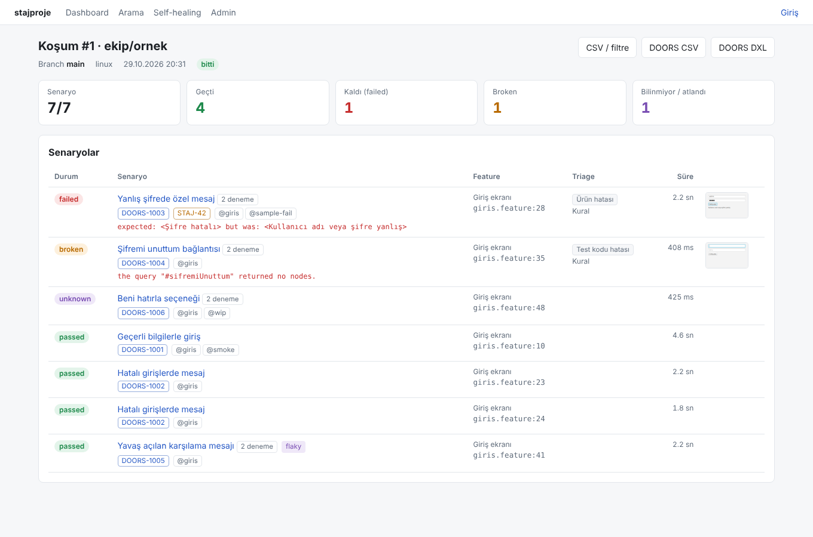

# raporcu — test sonuç merkezi

GitLab CI'da koşan JavaFX (Cucumber + TestFX) e2e testlerinin Allure sonuçlarını alır; canlı
durum, rapor, paylaşım, triage, Jira/DOORS ve OpenCode ile self-healing sağlar. Rust ile yazıldı:
tek ikili sunucu (`raporcu`, ~6 MB, ~30 MB RAM) + tek ikili CI aracı (`stajci`), SQLite,
Ubuntu ve Windows.



## Akış

```
test projesi pipeline'ı (GitLab runner, aynı makine)
  test   : stajci preflight → stajci start  (Xvfb / masaüstü, izleyici sonuçları anında gönderir)
  report : stajci upload → stajci finish     (toplu zip, rapor linki, kuyruk)
  fix    : stajci fix                        (OpenCode → auto-fix branch → MR)
                    │ localhost
                    ▼
raporcu: canlı ekran · rapor · arama/CSV · paylaşım · triage · Jira/DOORS · self-healing paneli
```

## Hızlı başlangıç

```bash
cargo build --release
cp .env.example .env          # CI_API_TOKEN, PUBLIC_URL, ...
./target/release/raporcu set-admin-password
./target/release/raporcu    # http://127.0.0.1:8080
```

Örnek sonuçları yüklemek için:

```bash
cd testdata/allure/ornek-giris && zip -q /tmp/s.zip * && \
curl -H "Authorization: Bearer $CI_API_TOKEN" --data-binary @/tmp/s.zip \
  "http://127.0.0.1:8080/api/ci/runs?project_path=ekip/ornek&branch=main"
```

## Evde / GitLab olmadan deneme

[`deneme/`](deneme/README.md): `./ev-denemesi.sh` (Linux) ya da `ev-denemesi.cmd` (Windows) sunucuyu açar ve örnek
JavaFX projesini gerçek testlerle koşturur; canlı ekran tarayıcıda açılır.

## Kendi test projene ekleme

1. `ornek-test-projesi/` — çalışan bir JavaFX + Cucumber + TestFX + Allure projesi. `pom.xml`,
   `junit-platform.properties`, `Hooks.java` (hata anında ekran görüntüsü), `VideoKaydi.java`
   (kalan senaryonun videosu) ve `features.txt` kendi projene kopyalanacak parçalardır.
   Ayrıntı: [`ornek-test-projesi/README.md`](ornek-test-projesi/README.md).
2. `.gitlab-ci.yml`'e tek `include` satırı: [`docs/YENI_PROJE_EKLEME.md`](docs/YENI_PROJE_EKLEME.md).
3. Test projesinde neler olmalı (adımlar, ekler, tag'ler, triage için hata türleri):
   [`docs/TEST_PROJESI_GEREKSINIMLERI.md`](docs/TEST_PROJESI_GEREKSINIMLERI.md).
4. Canlı ekran (şu an koşan senaryo/adım): projeye eklenecek Java dosyası ve ayar [`docs/CANLI_EKRAN_KURULUM.md`](docs/CANLI_EKRAN_KURULUM.md); nasıl çalıştığı [`docs/ANLIK_AKTARIM.md`](docs/ANLIK_AKTARIM.md).
5. Jira bug şablonu, zorunlu Jira alanları ve DOORS eşleşmesi (Admin > Ayarlar): [`docs/JIRA_DOORS_AYARLARI.md`](docs/JIRA_DOORS_AYARLARI.md).
6. Self-healing için OpenCode ya da Claude Code + vLLM, ajan ve skill tanımı, nasıl çağrıldığı: [`docs/KOD_AJANI_VLLM.md`](docs/KOD_AJANI_VLLM.md).
7. Makine kurulumu (Ubuntu Xvfb / Windows masaüstü oturumu, runner, tokenlar, gece zamanlaması):
   [`docs/GITLAB_CI_KURULUMU.md`](docs/GITLAB_CI_KURULUMU.md).

## Depo yapısı

| Yol | İçerik |
|-----|--------|
| `crates/raporcu` | sunucu: axum + askama/htmx + WebSocket, SQLite (`rusqlite` bundled) |
| `crates/stajci` | CI aracı: `preflight`, `start`, `watch`, `upload`, `finish`, `fix` |
| `crates/common` | Allure modeli/ayrıştırıcı, API tipleri, sürüm uyumu |
| `crates/rehearse` | prova: CI akışını yerelde benzetir (`cargo run -p rehearse`) |
| `crates/e2esmoke` | uçtan uca smoke (`cargo run -p e2esmoke`) |
| `migrations/` | numaralı SQL migration'ları (ikiliye gömülü) |
| `ci/gitlab/template/.gitlab-ci.yml` | merkezi CI şablonu |
| `ci/opencode/template/` | `opencode.json`, `fix` ajanı, `AGENTS.md` şablonu |
| `ci/claude/template/` | Claude Code: `CLAUDE.md`, `.claude/settings.json`, `.mcp.json` |
| `ci/skills/` | self-healing skill'leri (test projesinde `.claude/skills/`; OpenCode ve Claude Code ortak) |
| `ornek-test-projesi/` | örnek Java test projesi |
| `testdata/allure/` | gerçek `allure-results` örnekleri (testler bunları kullanır) |
| `deploy/` | systemd servisi, Windows kurulum betikleri |
| `docs/` | plan, kurulum, kararlar, pilot kontrol listesi, [anlık aktarım](docs/ANLIK_AKTARIM.md) |
| `docs/kod/` | [her kaynak dosyanın açıklaması](docs/kod/README.md) (dilden bağımsız) |
| `docs/PYTHON_GECIS.md`, `docs/python-iskelet/` | [Python'a geçiş rehberi](docs/PYTHON_GECIS.md) ve çalışan, testli Python iskeleti |

## Doğrulama

```bash
cargo clippy --all-targets -- -D warnings
cargo test                 # 105 test (Wine varsa: --target x86_64-pc-windows-gnu)
cargo run -p rehearse      # 44 prova adımı (sunucu + stajci gerçek süreç olarak)
cargo run -p e2esmoke      # 18 uçtan uca kontrol
cargo build --release --target x86_64-pc-windows-gnu -p raporcu -p stajci
```

Gereksinimlerin durumu: [`GEREKSINIMLER_1.md`](GEREKSINIMLER_1.md). Plan: [`docs/PLAN.md`](docs/PLAN.md).
Varsayımlar (açık sorular): [`docs/KARARLAR.md`](docs/KARARLAR.md).
